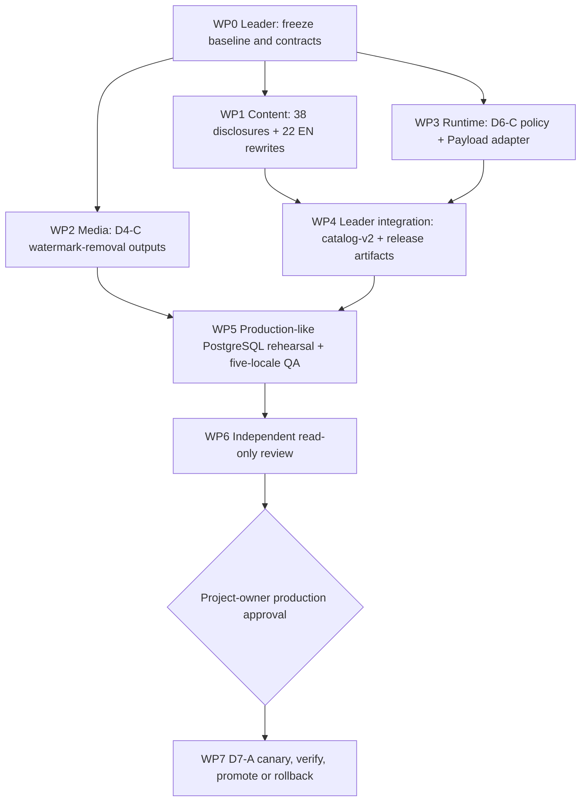

# US-055 Exec Plan

## Goal

Connect all four WingSide Why Travel roles to real, governed TourProduct
inventory while preserving the approved Home composition and editor control.

## Scope

In scope:

- Additive Payload configuration for four stable Why Travel slots.
- Manual TourProduct relationships and deterministic governed rules.
- Server-side readiness, tenant and locale projection.
- Controlled editorial copy/media/CTA inheritance and overrides.
- Migration or idempotent backfill of the initial four selections.
- Admin, component, integration, responsive and production proof.

Out of scope:

- Visitor UID, cookies, Redis preference profiles and behavioral events.
- Personalized or machine-learning ranking.
- Guided listing filters owned by US-054.
- New tour imports, availability or booking.
- Redesigning the approved Home section hierarchy.

## Risk Classification

Risk flags:

- Data model and additive Payload/PostgreSQL migration.
- Existing public Home behavior and CMS editing contract.
- Multisite and five-locale exposure.
- Public Tour Detail URL and product-truth contract.
- Cross-story dependency on US-049, US-050 and optionally US-054.
- Weak proof until admin curation and fail-closed rendering exist.

Hard gates:

- Never resolve unpublished, cross-site or display-incomplete tours.
- Never reintroduce static product title, price, media or product-detail URLs as
  a silent fallback.
- Never allow free-form product URLs to override the canonical same-site
  wrapper route.
- Do not introduce visitor identity or tracking under this story.

## Work Phases

1. Freeze slot keys, initial four tour mappings and inherit/override semantics.
2. Add the typed Page schema, server validation and additive migration.
3. Implement manual/rule resolution and the bounded Why Travel projection.
4. Update the Home renderer and Payload admin experience.
5. Backfill the approved selections with dry-run and idempotence proof.
6. Run local, PostgreSQL, browser, five-locale, tenant and responsive checks.
7. Promote through canary/production and update Harness and Plane evidence.

## Remaining Delivery Plan — S3

- Plan date: 2026-07-28
- Mode: `plan`
- Scale: `S3`
- Integration base: `5175f0c`
- Concurrency: maximum three workers plus one leader
- Production authority: not granted by this plan

This remaining-work plan implements the project-owner package `D1-A`, `D2-A`,
`D3-A`, `D4-C`, `D5-A`, `D6-C` and `D7-A` recorded in
`release-decisions-2026-07-28.md`.

Provider probe on the planning baseline found native Codex and Claude CLI
available, Grok without reliable non-interactive execution, and Gemini absent.
Editing packages should therefore use native Codex workers by default. An
external provider may be used only for a captured read-only review after its
authentication and command contract are re-probed; it is not on the critical
path.

### Objective and definition of done

US-055 is ready for a production approval request only when:

- all 38 governed pricing-disclosure rows have exact EN/VI/IT/ES/PT wording and
  no source row is lost or silently collapsed;
- the exact 22 English tour records contain governed WingSide rewrites and pass
  recursive source-brand, shouting and SEO-import lint;
- the four already-approved locale artifacts are incorporated without byte or
  checksum drift;
- the selected media set has completed `D4-C` watermark-removal outputs, exact
  inventory, hashes, visual review and OCR/frame checks;
- the `D6-C` development-team approval policy is implemented as an explicit,
  testable policy rather than as a bypass of the signature contract;
- a genuine Payload/PostgreSQL transaction adapter and protected target-proof
  material work in a production-like rehearsal;
- apply → verify → rollback → verify passes on a full PostgreSQL clone;
- exact 22 listing and 22 detail routes plus Home → Tour Detail pass for
  EN/VI/IT/ES/PT with fallback disabled;
- the canary package, rollback package and evidence bundle are complete; and
- the project owner issues a separate production data-write and deployment
  instruction.

### Dependency graph

### Wave 0 — leader baseline

#### WP0: Freeze inventory, paths and evidence contracts

- Owner: leader.
- Mode: read-only plus planning artifacts.
- Base SHA: `5175f0c`.
- Dependencies: none.
- Tasks:
  - create three isolated worktrees from the same immutable base;
  - freeze the ordered 22-tour inventory, 38 pricing rows, four approved locale
    hashes, selected media inventory and current PostgreSQL schema target;
  - assign disjoint mutable paths;
  - initialize durable orchestrator run state outside the repository;
  - record exact validation commands and stop conditions.
- Evidence:
  - clean base status and SHA;
  - frozen inventory checksums;
  - worktree and allowed-path registry.
- Stop conditions:
  - any source inventory differs from the approved baseline;
  - any approved `vi`/`it`/`es`/`pt` artifact hash changes before WP1 starts;
  - any worker cannot be isolated to its allowed paths.

### Wave 1 — three parallel workers

#### WP1: Author governed tour content

- Owner: content/editorial worker.
- Mode: edit in isolated worktree.
- Dependencies: WP0.
- Decisions: `D1-A`, `D2-A`, `D5-A`.
- Allowed paths:
  - `app/scripts/data/wingsside-tour-editorial/**`;
  - a new dedicated English-candidate artifact directory under
    `app/scripts/data/`;
  - content-only evidence under the US-055 story directory.
- Forbidden paths:
  - production import/runtime and approval-policy code;
  - media binaries;
  - migrations and production configuration.
- Tasks:
  - author EN source wording for the 38 peak-season, fuel-surcharge and
    compulsory-dinner disclosures;
  - author corresponding VI/IT/ES/PT labels without changing the already
    approved tour-content bytes outside those new disclosure fields;
  - write governed WingSide English content for the exact 22 tours;
  - preserve route, itinerary, meal, service-row and factual contracts;
  - generate checksums and an editorial redline report.
- Acceptance:
  - 22/22 English inventory and 38/38 disclosure disposition;
  - five locales present for every governed disclosure;
  - no missing or duplicate slug/source row ID;
  - no forbidden vendor phrase, shouting or machine-translation marker;
  - existing four locale hashes either remain identical or any necessary
    additive artifact is isolated and separately checksummed.
- Required checks:
  - focused English editorial and localization unit tests;
  - JSON/schema validation;
  - deterministic checksum rerun;
  - `git diff --check`.

#### WP2: Produce and verify D4-C media outputs

- Owner: media worker.
- Mode: edit in isolated worktree.
- Dependencies: WP0.
- Decision: `D4-C`.
- Allowed paths:
  - dedicated processed-media output and manifest directories;
  - `app/scripts/audit-wingsside-tour-media*.ts`;
  - `app/scripts/lib/wingsSideTourMedia*.ts`;
  - their focused unit tests and US-055 media evidence.
- Forbidden paths:
  - overwrite of the sealed source-media input;
  - editorial catalog data;
  - production import/runtime code and credentials.
- Tasks:
  - freeze source bytes before processing;
  - generate watermark-removal output as new files, never by overwriting source;
  - bind source/output hashes and tour/media mappings;
  - run exact-inventory, duplicate-reuse, OCR/frame and manual visual checks;
  - mark any image failed if removal introduces visible artifacts, missing
    subjects or misleading tour representation.
- Acceptance:
  - complete governed media inventory for all 22 tours;
  - zero missing or empty output files;
  - every output traces to one frozen source hash;
  - zero detected watermark text in OCR/frame results;
  - independent visual review has no unresolved critical finding.
- Required checks:
  - focused media audit/evidence unit tests;
  - canonical media manifest validation;
  - source immutability comparison;
  - visual contact sheet and per-file checksum report.

#### WP3: Implement D6-C runtime and transaction boundary

- Owner: runtime/security worker.
- Mode: edit in isolated worktree.
- Dependencies: WP0.
- Decision: `D6-C`.
- Allowed paths:
  - tour editorial production importers;
  - `wingsSideReleaseWriteGuard`, catalog authoring, English editorial runtime
    and related focused tests;
  - a dedicated application-owned Payload adapter module.
- Forbidden paths:
  - editorial text/data artifacts;
  - media binaries and processed outputs;
  - production secrets, live databases and deployment configuration.
- Tasks:
  - replace the independent-approver identity contract with an explicit
    project-owner-authorized development-team approver role;
  - retain artifact signatures, purpose separation, immutable inputs, phase
    binding, target proofs and transaction checks;
  - implement the genuine Payload/PostgreSQL adapter;
  - keep raw mutation entry points unexported and fail closed on missing policy,
    key, target, checksum or transaction evidence;
  - add negative tests for self-authored policy substitution, signature
    fabrication, wrong database, stale proof and approval replay.
- Acceptance:
  - `D6-C` is represented by a named, versioned policy and auditable signer
    identity, not a Boolean or disabled guard;
  - no CLI argument can replace a protected policy/key/target;
  - apply/verify/rollback use the same bound catalog and database target;
  - all adversarial and focused runtime tests pass.
- Required checks:
  - catalog authoring, write-guard, English runtime and production importer unit
    suites;
  - TypeScript and ESLint on changed paths;
  - independent diff review before integration.
- Stop conditions:
  - implementation requires exporting a raw write function;
  - protected keys would need to be committed or printed;
  - the change disables signature, checksum, target or transaction validation.

### Wave 2 — leader integration and artifact generation

#### WP4: Integrate immutable worker commits

- Owner: leader.
- Mode: integration in a clean worktree.
- Dependencies: accepted WP1 and WP3; consume WP2 manifest contract without
  modifying WP2-owned media.
- Tasks:
  - validate each worker report and path ownership;
  - integrate immutable commits in dependency order;
  - resolve schema contracts centrally;
  - generate canonical source manifest, review-only catalog-v2 draft,
    full-candidate checksum and approval snapshot;
  - sign catalog/media artifacts under the implemented `D6-C` policy;
  - generate dry-run PostgreSQL plans for localization, English editorial and
    Home curation.
- Acceptance:
  - catalog contains exact 22 tours, 38 disclosure rows and five locales;
  - four approved locale input hashes match the approval record;
  - no service row ID is lost;
  - catalog, plan, approval snapshot and media manifest cross-check exactly;
  - full unit, component, integration, TypeScript, lint and build gates pass.

### Wave 3 — rehearsal, browser QA and independent review

#### WP5: Run production-like rehearsal

- Owner: leader, with read-only QA workers where useful.
- Mode: data dry-run and disposable full-clone rehearsal only.
- Dependencies: WP2 and WP4 accepted.
- Tasks:
  - provision a production-like PostgreSQL clone and Redis;
  - verify encrypted backup and perform a restore drill;
  - run plan → apply → verify → rollback → verify;
  - re-apply to the rehearsal clone and audit Home curation;
  - run exact inventory, tenant isolation, enquiry smoke and the five-locale
    browser matrix at 390px and 1440px.
- Acceptance:
  - exact 22 listing and 22 detail routes for each locale;
  - no implicit EN fallback;
  - four Why Travel slots link to eligible same-site real tours;
  - zero unresolved P0/P1 browser, data-loss, media or security finding;
  - rollback returns every governed row and checksum to the before state.

#### WP6: Independent release review

- Owner: a read-only reviewer that did not author WP1–WP5.
- Mode: audit.
- Dependencies: WP5 complete.
- Tasks:
  - reproduce catalog substitution, wrong-target, stale-proof, self-approval,
    row-loss, locale fallback and adverse-media-evidence attacks;
  - inspect raw rehearsal logs and artifacts rather than worker summaries;
  - issue `SHIP`, `HOLD` or `REWORK` with finding severity and evidence.
- Acceptance:
  - zero P0/P1 false-pass;
  - every release assertion has a reproducible command or immutable artifact;
  - residual P2 items are explicitly deferred and do not weaken release gates.

### Wave 4 — approval-gated canary

#### WP7: Execute D7-A canary and controlled promotion

- Owner: leader/release operator.
- Mode: approval-gated production operation.
- Dependencies: WP6 `SHIP` and a new explicit project-owner approval naming the
  target, release SHA, database plan, backup, rollback and canary scope.
- Tasks:
  - verify production health and encrypted backup;
  - apply the exact signed plans;
  - deploy immutable release SHA to canary;
  - run five-locale, four-tenant, enquiry and media smoke;
  - promote only when all gates are green; otherwise rollback code and data.
- Evidence:
  - release/image SHA, plan/catalog/media checksums;
  - backup and restore-drill reference;
  - apply/verify logs and rollback package;
  - canary screenshots, HTTP/DB/Redis health and browser matrix;
  - final Plane and Harness status.

### Scheduling and concurrency

| Wave | Concurrent work | Expected critical path |
| --- | --- | --- |
| 0 | Leader only | Baseline and contracts |
| 1 | WP1, WP2 and WP3 in parallel | Slowest of content, media or runtime |
| 2 | Leader integration | Catalog-v2 and combined checks |
| 3 | Rehearsal followed by independent review | PostgreSQL and browser evidence |
| 4 | Approval-gated release | Canary observation and promotion |

WP1, WP2 and WP3 must not edit the same paths. A worker that needs a
cross-owned change reports the required interface to the leader and stops; it
does not edit outside its package.

### Approval gates

- Gate A — worker integration: leader accepts immutable worker SHAs after path
  and evidence verification.
- Gate B — rehearsal data operations: limited to a disposable production-like
  clone; no production authority is implied.
- Gate C — production data write and deploy: requires a new explicit user
  approval after WP6.
- Gate D — full traffic: requires green canary proof and a reversible rollback
  window.

## Stop Conditions

Pause for human confirmation if:

- Editorial wants a slot to remain a non-tour CTA.
- Rule-based selection needs signals outside governed taxonomy and duration.
- A media override would make the card appear to represent a different tour.
- Implementation requires weakening US-049/US-050 eligibility or tenant rules.
- The work expands into visitor identity, behavioral tracking or
  personalization.
- A worker needs production credentials, a live database write, push, merge,
  deployment or traffic switching.
- The selected D4-C media inventory is incomplete or source bytes cannot be
  frozen before processing.
- D6-C can only be implemented by disabling a signature/checksum/target check
  instead of defining an explicit auditable approval policy.

## R4 closure appendix

WP0–WP5 are locally integrated through immutable HEAD
`ef729d768e6d6f01049374f04f20491fb3ea0b76`. The protected 22/116/331/38/5
catalog, disposable PostgreSQL lifecycle, backup/restore drill, applied-state
110-route gate, governed 40-case Home matrix, rollback and cleanup are
technically accepted. Final evidence SHA-256 is
`2151bcdaa470288b333e1390b73b42c0fe98f7ab27a98f74305450f32a622706`;
journal SHA-256 is
`eb3393ed189a256cf1630e8fd1fe098ad4d58391a04d5bcf7340a4eac93ac0e5`.

WP2 evidence is accepted as an exact audit, but D4-C is not complete: 220
hashes remain positive, 366 are clean, 29 were reclassified, four candidates
were rejected and zero faithful replacements were accepted. WP6 has not issued
a combined release `SHIP`. WP7 remains approval-gated and was not executed.
The media-completion, production-authority and canary definitions of done
therefore remain unmet; the story stays in progress / HOLD.

## R5 production-gate appendix

The owner granted Gate C production authority on 2026-07-29. The independent
combined WP6 review executed next and returned `HOLD` after 145/145 focused
adverse-release tests passed. This is not a `SHIP` decision:

- D4-C remains 220 positive / zero accepted replacements;
- protected rights/publication evidence is absent; and
- no exact production-target backup, restore drill, signed apply/rollback or
  protected target-proof package exists.

The separate media gate confirms 221 affected references on 21/22 tours,
including five hero references, and no production-safe media manifest.
Production preflight identified the current release as
`fadd22c68de26d0c1fdd281d77bac58b25f12625`, while the candidate
`ef729d768e6d6f01049374f04f20491fb3ea0b76` is not published to `origin` and
its protected release bindings are absent.

Because WP7 depends on WP6 `SHIP`, D7-A stopped before plan apply, database
write, deploy, canary, traffic switch and promotion. Production authority
remains recorded; the failed dependency must be resolved and WP6 must return
`SHIP` before that authority can be exercised.

## R6 media acceptance appendix

The owner subsequently accepted the current media set on 2026-07-29 and
instructed the release to continue. That decision reclassifies the R5 D4-C
media finding from a mandatory replacement/removal blocker into an accepted
publication risk for this release. The factual media counts from R5 remain
unchanged and must stay visible in the release record.

D7-A still requires the remaining production-safety package before mutation:
immutable release source, exact production-target backup, restore drill, signed
catalog/plan binding, rollback release binding, canary validation and live
post-release QA.
