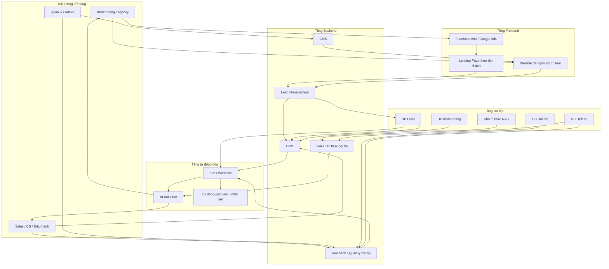
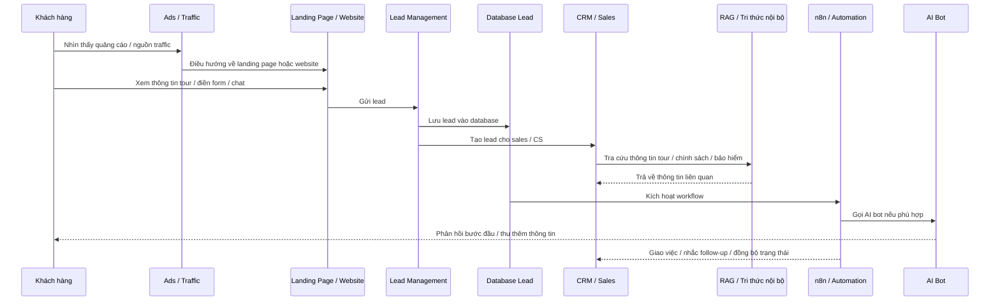

# Kiến trúc hệ thống WingsTravel

## 1. Mục đích

Tài liệu này dùng để mô tả cách hình dung hệ thống tổng thể cho mảng inbound theo các tầng:

- Frontend
- Backend
- Dữ liệu
- Tự động hóa

Mục tiêu không phải mô tả thiết kế kỹ thuật cuối cùng, mà là:

- Tạo một mô hình đủ rõ để trao đổi với đối tác
- Giải thích quan hệ giữa website, landing page, lead, dữ liệu nội bộ và AI
- Làm rõ cách hệ thống có thể lớn dần theo từng giai đoạn

## 2. Mô hình theo các tầng

### Tầng Frontend

- Website đa ngôn ngữ
- Website cung cấp thông tin tour
- Website tối ưu theo nhóm khách hàng / agency
- Landing page tùy biến theo từng tệp khách hàng hoặc từng sản phẩm
- Các kênh quảng cáo như Facebook Ads, Google Ads kéo traffic vào landing page / website

### Tầng Backend

- CRM
- RAG phục vụ khai thác tri thức nội bộ
- CMS
- Hệ thống vận hành / quản lý nội bộ
- Hệ thống quản lý lead

### Tầng dữ liệu

- Kho tri thức cho RAG
- Database lead
- Database khách hàng
- Database đối tác
- Database dịch vụ
- Database production phù hợp cho hệ nhiều site, nhiều người dùng
- Cache / KV layer để tối ưu tốc độ phản hồi khi hệ mở rộng

### Tầng tự động hóa

- n8n
- AI bot chat
- Workflow giao việc / automation

## 3. Cách hiểu vai trò của từng tầng

### Frontend

Là lớp tiếp xúc với thị trường:

- đưa thông tin ra ngoài
- tiếp cận đúng từng tệp khách hàng
- nhận lead từ quảng cáo, form, chatbot, website

### Backend

Là lớp điều hành và quản trị:

- lưu trữ và theo dõi lead
- quản lý nội dung
- quản lý thông tin vận hành nội bộ
- hỗ trợ đội sale / chăm sóc khách
- kết nối dữ liệu nội bộ với AI qua RAG

### Dữ liệu

Là nền cho toàn bộ hệ thống:

- lưu lead
- lưu lịch sử trao đổi
- lưu thông tin dịch vụ, tour, đối tác
- lưu tri thức nội bộ như chính sách, bảo hiểm, quy trình

### Tự động hóa

Là lớp tối ưu:

- tự động phản hồi bước đầu
- phân loại lead
- giao việc
- đồng bộ dữ liệu
- hỗ trợ chatbot và các workflow tự động

## 4. Sơ đồ kiến trúc tổng thể

## 5. Sơ đồ luồng tương tác chính

## 6. Cách nên trình bày với đối tác

Không nên trình bày theo kiểu quá kỹ thuật.

Nên nói theo hướng:

- Frontend là lớp tiếp cận khách hàng và tạo lead
- Backend là lớp quản lý, vận hành và hỗ trợ sale
- Dữ liệu là nền cho cả vận hành và AI
- Automation là lớp tối ưu sau khi quy trình lõi đã đủ rõ

Thông điệp chính:

> Hệ thống không nên chỉ dừng ở một website. Website và landing page chỉ là lớp ngoài để tiếp cận khách và tạo lead. Giá trị lâu dài nằm ở việc lead được lưu, được xử lý, được đo lường, và dữ liệu nội bộ được đưa vào hệ thống để hỗ trợ vận hành và AI về sau.

## 7. Ghi chú triển khai

- Không cần xây toàn bộ các tầng ngay từ đầu
- Giai đoạn đầu nên ưu tiên frontend + lead management + dữ liệu nền
- Các lớp như CRM đầy đủ, RAG, automation, AI bot có thể mở dần theo giai đoạn
- Kiến trúc cuối cùng sẽ còn phụ thuộc vào tổ chức vận hành thực tế của phía đối tác

### Ghi chú hạ tầng dữ liệu

- Với mô hình nhiều site và nhiều người cùng vận hành, production không nên dùng database file cục bộ
- Hướng phù hợp là:
  - `PostgreSQL` làm database chính
  - `Redis` làm lớp cache / KV hỗ trợ hiệu năng
- `SQLite` chỉ phù hợp cho local development hoặc demo kỹ thuật
