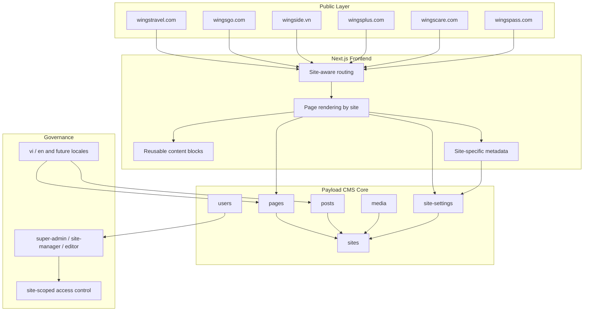

# Kiến trúc đề xuất nội bộ WingsTravel theo hướng Payload

## 1. Mục đích

Tài liệu này là bản kiến trúc nội bộ để dùng cho:

- team dev
- AI Agent
- tài liệu định hướng implementation
- căn cứ ra quyết định cho phase 1 và điểm mở rộng phase 2-4

Tài liệu này không nhằm trình bày bán hàng.

Nó phải đủ rõ để:

- biết hệ đang build theo mô hình nào
- biết Payload giữ vai trò gì và không giữ vai trò gì
- biết cấu trúc repo và data model cần bám
- giảm việc AI Agent hoặc dev đi lệch hướng

## 2. Kết luận kiến trúc

Hướng được chọn là:

- `Payload Website Template` làm nền
- `Next.js + Payload` trong cùng một codebase
- `Payload` giữ vai trò `CMS + multisite content platform`
- `PostgreSQL` là database chính cho staging và production
- `Redis` là lớp hỗ trợ cho cache, KV và tối ưu hiệu năng
- frontend public render theo `site`
- một repo chung phục vụ nhiều site cùng hệ sinh thái `WingsTravel`

Không chọn hướng:

- ghép một theme có sẵn làm lõi
- tách rời CMS và frontend quá sớm
- biến phase 1 thành CRM hoặc workflow system

## 3. Nguyên tắc kiến trúc

### 3.1. Payload là content core

Payload ở phase 1 chỉ nên giữ:

- multi-site / multi-domain
- localization
- page and content management
- landing page builder ở mức vừa đủ
- auth và access control
- media
- preview, draft, publish

Không nên nhét vào phase 1:

- CRM đầy đủ
- booking engine
- payment flow
- automation orchestration sâu
- AI workflow
- reporting nâng cao

### 3.2. Frontend public là site-aware

Frontend không phải một website đơn lẻ.

Nó là một lớp render chung cho:

- `WingsTravel`
- `WingsGo`
- `wingside.vn` (mã tenant kỹ thuật `wing-side`)
- `WingsPlus`
- `WingsCare`
- `WingsPass`

Mỗi site có thể khác nhau ở:

- domain
- nội dung
- navigation
- footer
- brand
- SEO
- user quản trị

### 3.3. Một codebase, nhiều site

Ở phase 1, chọn một codebase chung vì:

- giảm chi phí vận hành
- giảm lặp logic
- dễ tái sử dụng block và component
- thuận lợi cho role/site-scoped access
- dễ nhân site mới nhanh hơn

### 3.4. Tách cái gì là dùng chung, cái gì là theo site

Theo site:

- pages
- posts
- media nếu cần scope
- categories
- site settings
- SEO mặc định
- header/footer data
- user access scope

Dùng chung:

- codebase
- block definitions
- layout engine
- auth framework
- access rules framework
- frontend component system

## 4. Kiến trúc logical

## 5. Cấu trúc implementation hiện tại trong repo

### 5.1. App chính

- App đang chạy trong [app](/E:/repo/WingsTravel/app)
- Payload app hiện dùng `SQLite` cho local bootstrap
- Source chính nằm trong [app/src](/E:/repo/WingsTravel/app/src)

### 5.2. Mô hình database và hạ tầng dữ liệu

Mô hình được chốt cho dự án là:

- `Local development`: `SQLite`
- `Staging`: `PostgreSQL`
- `Production`: `PostgreSQL + Redis`

Vai trò của từng thành phần:

- `PostgreSQL` là database chính cho:
  - `sites`
  - `site-settings`
  - `pages`
  - `posts`
  - `media metadata`
  - `users`
  - role và access scope
  - localized content
  - Payload jobs data
- `Redis` là lớp hỗ trợ cho:
  - cache tạm
  - KV data
  - rate limiting nếu cần
  - site lookup cache
  - navigation / metadata cache
  - dữ liệu ngắn hạn phục vụ scale hoặc worker

Nguyên tắc:

- không dùng `Redis` thay cho database chính
- không dùng `SQLite` cho staging hoặc production

### 5.3. Những gì đã có

- `sites` collection
- `site-settings` collection
- roles:
  - `super-admin`
  - `site-manager`
  - `editor`
- localization:
  - `vi`
  - `en`
- site-scoped content cho:
  - `pages`
  - `posts`
  - `media`
  - `categories`
- local test theo path prefix:
  - `/wingstravel`
  - `/wingsgo`
  - `/wingsside`
  - `/wingsplus`
  - `/wingscare`
  - `/wingspass`
- header/footer/site branding theo từng site
- site-specific metadata và SEO mặc định

### 5.4. File trọng yếu cần AI Agent biết

- cấu hình Payload: [payload.config.ts](/E:/repo/WingsTravel/app/src/payload.config.ts)
- site settings: [SiteSettings.ts](/E:/repo/WingsTravel/app/src/collections/SiteSettings.ts)
- site context: [siteContext.ts](/E:/repo/WingsTravel/app/src/utilities/siteContext.ts)
- site paths: [sitePaths.ts](/E:/repo/WingsTravel/app/src/utilities/sitePaths.ts)
- lấy settings theo site: [getSiteSettings.ts](/E:/repo/WingsTravel/app/src/utilities/getSiteSettings.ts)
- metadata: [generateMeta.ts](/E:/repo/WingsTravel/app/src/utilities/generateMeta.ts)
- frontend layout: [layout.tsx](</E:/repo/WingsTravel/app/src/app/(frontend)/layout.tsx>)
- rewrite local multisite: [next.config.ts](/E:/repo/WingsTravel/app/next.config.ts)
- seed multisite: [seed-subsites.ts](/E:/repo/WingsTravel/app/scripts/seed-subsites.ts)

## 6. Domain model phase 1

### 6.1. `sites`

Vai trò:

- root entity cho toàn bộ multisite
- mapping giữa domain, locale, user scope, content scope

Các field cốt lõi:

- `name`
- `code`
- `primaryDomain`
- `additionalDomains`
- `supportedLocales`
- `defaultLocale`
- `isActive`

### 6.2. `site-settings`

Vai trò:

- thay thế cho cách dùng global đơn lẻ
- chứa cấu hình riêng từng site

Các field cốt lõi:

- `siteName`
- `tagline`
- `branding.logoText`
- `branding.brandColor`
- `branding.accentColor`
- `branding.logoImage`
- `seo.defaultTitle`
- `seo.titleSuffix`
- `seo.defaultDescription`
- `seo.defaultImage`
- `seo.canonicalDomain`
- `headerNavItems`
- `footerNavItems`
- `supportEmail`
- `supportPhone`
- `footerNote`

### 6.3. `pages`

Vai trò:

- page chuẩn cho site
- homepage, about, contact, service pages

Ràng buộc:

- phải có `site`
- nội dung theo locale
- slug có thể alias theo site nếu cần route test local

### 6.4. `posts`

Vai trò:

- news, article, guide, editorial content

### 6.5. `media`

Vai trò:

- quản lý asset theo site
- phục vụ brand, hero, SEO image, content image

### 6.6. `users`

Vai trò:

- auth cho CMS
- gắn role và site scope

## 7. Vai trò Payload theo từng phase

### Phase 1

Payload là:

- CMS core
- multisite layer
- localization layer
- content publishing layer

### Phase 2

Payload mở thêm:

- block library hoàn chỉnh hơn
- structured service content
- landing page variations
- SEO governance tốt hơn

Block library nên được mở rộng bằng registry/preset có kiểm soát:

- preset do code quản lý để giữ chất lượng multisite
- editor chọn preset hoặc presentation variant, không nhập CSS tùy ý
- trang đã tạo lưu snapshot trong `Pages.layout`
- nguồn cảm hứng bên ngoài như VibeUI chỉ dùng làm taxonomy tham khảo, không
  sao chép code, asset hoặc nhận diện

Hero dùng registry riêng có capability và preset:

- theme và hero presentation là hai trục độc lập
- site-settings giữ default presentation/behavior
- page giữ content/media và có thể override
- template render do code quản lý; CMS chỉ ghép các option an toàn
- multi-image, carousel và video phải có accessibility/performance contract

### Phase 3

Payload có thể giữ:

- lead capture cơ bản
- form submission
- campaign source data

Nhưng không nên mặc định thành:

- CRM đầy đủ
- workflow engine cho sales/ops

### Phase 4

Payload phù hợp để làm:

- knowledge source
- structured content source cho AI/RAG
- source of truth cho public content

## 8. Định nghĩa phạm vi phase 1

### In scope

- site đầu tiên go-live được
- multisite-ready architecture
- site settings per site
- brand/SEO per site
- localization `vi/en`
- pages/posts/media/categories theo site
- role-based access theo site
- frontend render theo site

### Out of scope mặc định

- booking flow
- payment
- CRM pipeline nhiều bước
- operator workflow
- AI bot
- automation engine
- analytics nâng cao

## 9. Tiêu chuẩn implementation cho dev và AI Agent

### 9.1. Khi thêm tính năng mới

Phải tự hỏi đủ 5 câu:

1. Tính năng này là dùng chung toàn hệ hay theo site?
2. Tính năng này có cần localized không?
3. Quyền xem/sửa của `site-manager` và `editor` là gì?
4. Dữ liệu này nên nằm trong Payload hay nên để phase sau?
5. Có làm tăng coupling sai giữa content layer và ops layer không?

### 9.2. Khi thêm collection mới

Mặc định cân nhắc:

- có field `site` hay không
- có `localized` field hay không
- có cần access scope theo site không
- có cần xuất hiện trên frontend public không

### 9.3. Khi sửa frontend

Phải giữ:

- site-aware route handling
- site-aware links
- site-aware metadata
- site-specific header/footer/settings

Không được hardcode lại:

- tên site
- title SEO mặc định
- logo text
- navigation dùng chung cho mọi site

### 9.4. Khi sửa admin

Không được làm mất:

- site scoping
- role scoping
- editor experience tối thiểu

### 9.5. Khi xử lý local test

Ưu tiên test qua:

- `http://localhost:3000/wingstravel`
- `http://localhost:3000/wingsgo`
- `http://localhost:3000/wingsside`
- `http://localhost:3000/wingsplus`
- `http://localhost:3000/wingscare`
- `http://localhost:3000/wingspass`

Lý do:

- phase 1 đang dùng path prefix local test thay cho full domain mapping

## 10. Rủi ro kỹ thuật hiện tại

### 10.1. SQLite chỉ phù hợp local

Đã có triển khai chạy local bằng SQLite, nhưng đây không phải lựa chọn phù hợp lâu dài cho multisite production.

Khuyến nghị:

- staging và production dùng `PostgreSQL`
- bổ sung `Redis` cho cache và KV layer khi chuẩn bị production

Lý do:

- hệ có nhiều site, nhiều editor, nhiều quan hệ dữ liệu
- cần concurrency và migration ổn định hơn
- cần lớp cache để giữ response time tốt hơn khi hệ mở rộng

### 10.2. Template Payload còn nhiều noise kiểu mẫu

Một số phần từ template gốc vẫn còn:

- globals cũ
- generated types lớn
- TS noise từ ecosystem template

Cần tiếp tục dọn theo từng phase, không làm một lần quá lớn.

### 10.3. Dễ trượt phạm vi

Rủi ro lớn nhất không phải kỹ thuật mà là:

- lạm phát scope
- nhét lead/ops/AI quá sớm vào phase 1

## 11. Backlog kiến trúc ưu tiên tiếp theo

### Ưu tiên cao

- tách `services` collection riêng cho nội dung dịch vụ
- chuẩn hóa block library cho landing page
- bổ sung social links / contact schema per site
- bổ sung canonical/domain mapping thật cho production
- chuyển DB sang `PostgreSQL`
- chuẩn bị `Redis` cho cache và KV layer

### Ưu tiên trung bình

- dashboard admin tối giản theo role
- workflow publish rõ hơn
- media governance tốt hơn theo site
- cache strategy theo site

### Ưu tiên sau

- lead capture collection
- campaign collection
- integration n8n / webhook layer

## 12. Quy tắc ra quyết định

Nếu có hai hướng:

- một hướng nhanh nhưng làm site coupling tệ
- một hướng chậm hơn chút nhưng giữ multisite model sạch

thì ưu tiên hướng giữ model sạch.

Nếu có hai hướng:

- một hướng dùng đúng 20 phần trăm Payload cần thiết
- một hướng mở thêm nhiều capability nhưng chưa có nhu cầu thật

thì chọn hướng đầu.

## 13. Kết luận

Kiến trúc được chọn cho `WingsTravel` là:

- `Payload-first`
- `multisite-ready`
- `site-aware frontend`
- `content-centric`
- `phase 1 chỉ giải quyết content, brand, locale, quyền và khả năng mở rộng`

Đây là nền phù hợp để:

- release site đầu tiên nhanh
- mở thêm site con cùng hệ
- giữ hệ thống đủ gọn để tiếp tục phát triển phase 2-4

Và đây cũng là context chuẩn mà dev nội bộ hoặc AI Agent cần bám khi triển khai tiếp.
