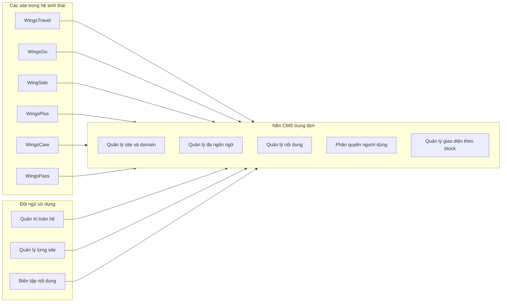

# Đề xuất kiến trúc giai đoạn 1 cho WingsTravel

## 1. Mục tiêu

Đề xuất này nhằm xây cho `WingsTravel` một nền website và CMS có thể:

- triển khai site đầu tiên bài bản
- sẵn sàng mở rộng sang nhiều site trong cùng hệ sinh thái
- quản lý nội dung theo nhiều ngôn ngữ
- phân quyền quản trị theo từng site
- tạo nền ổn định cho các giai đoạn mở rộng sau

## 2. Định hướng kiến trúc được đề xuất

Chúng tôi đề xuất xây hệ thống theo mô hình:

- một nền quản trị nội dung chung
- nhiều site con có thể vận hành trên cùng nền đó
- mỗi site có thể có domain, nội dung, giao diện và người quản lý riêng

Theo định hướng này, hệ thống có thể phục vụ các site như:

- `WingsTravel`
- `WingsGo`
- `WingSide`
- `WingsPlus`
- `WingsCare`
- `WingsPass`

Điểm quan trọng là:

- cùng một nền kỹ thuật
- nhưng vẫn tách được nội dung và vận hành theo từng site

Về mặt hạ tầng dữ liệu, mô hình phù hợp cho hệ này là:

- `PostgreSQL` làm database chính cho nội dung và quản trị
- `Redis` làm lớp hỗ trợ cache để tối ưu hiệu năng khi hệ mở rộng

## 3. Kiến trúc tổng quan

## 4. Hệ thống sẽ gồm những lớp gì

### 4.1. Lớp website public

Đây là phần khách hàng cuối nhìn thấy.

Bao gồm:

- trang chủ
- trang giới thiệu
- trang dịch vụ / tour
- trang chi tiết
- trang liên hệ
- landing page cho dịch vụ, thị trường hoặc campaign

### 4.2. Lớp quản trị nội dung

Đây là phần đội ngũ nội bộ sử dụng để:

- tạo và cập nhật nội dung
- quản lý nhiều ngôn ngữ
- thay đổi nội dung theo từng site
- xem trước trước khi publish

Để lớp này vận hành ổn định cho mô hình nhiều site và nhiều người dùng, cần dùng kiến trúc dữ liệu phù hợp với production, thay vì các mô hình database file cục bộ chỉ phù hợp cho phát triển nội bộ.

### 4.3. Lớp quản lý nhiều site

Lớp này cho phép:

- một hệ thống chung quản lý nhiều site
- mỗi site có thông tin riêng
- mỗi site có domain riêng
- mỗi site có người phụ trách riêng

### 4.4. Lớp phân quyền

Lớp này đảm bảo:

- quản trị toàn hệ nhìn thấy toàn bộ
- quản lý site chỉ thấy site mình phụ trách
- biên tập viên chỉ làm việc trong phạm vi được giao

## 5. Những gì phù hợp nhất cho giai đoạn 1

Trong giai đoạn 1, kiến trúc này tập trung vào đúng 5 nhóm mục tiêu:

- multi-domain / multi-site
- đa ngôn ngữ
- giao diện website và landing page
- quản lý nội dung
- phân quyền

Đây là phần đủ để:

- đưa site đầu tiên vào vận hành
- tạo nền sẵn sàng cho các site tiếp theo
- giúp đội ngũ chủ động cập nhật nội dung

## 6. Các thành phần chính được đề xuất

### 6.1. Quản lý nhiều site

Hệ thống sẽ có cấu trúc để mỗi site:

- có tên riêng
- có domain riêng
- có nội dung riêng
- có cấu hình giao diện và thông tin riêng

### 6.2. Quản lý đa ngôn ngữ

Mỗi site có thể quản lý nội dung theo các ngôn ngữ đã chốt.

Điều này giúp:

- cùng một dịch vụ có thể hiển thị theo từng thị trường
- đội ngũ cập nhật nội dung trong cùng một hệ quản trị

### 6.3. Quản lý giao diện linh hoạt

Website và landing page sẽ được xây theo cấu trúc có thể tái sử dụng.

Điều này giúp:

- tạo page nhanh hơn
- giữ tính nhất quán
- vẫn linh hoạt khi cần nội dung riêng cho từng site hoặc từng campaign

### 6.4. Quản lý thương hiệu theo từng site

Mỗi site có thể có riêng:

- tên hiển thị
- màu thương hiệu
- thông tin liên hệ
- menu
- footer
- thiết lập SEO cơ bản

### 6.5. Phân quyền người dùng

Hệ thống sẽ có các nhóm quyền cơ bản:

- quản trị toàn hệ
- quản lý theo site
- biên tập nội dung

## 7. Lợi ích của mô hình này với WingsTravel

### 7.1. Không phải làm lại từ đầu khi mở thêm site

Khi cần mở thêm site mới, có thể tận dụng lại:

- nền CMS
- cấu trúc giao diện
- logic phân quyền
- quy trình quản trị nội dung

### 7.2. Giữ được sự tách biệt giữa các site

Mỗi site có thể có:

- nội dung riêng
- người quản lý riêng
- định hướng thương hiệu riêng

Nhưng vẫn nằm trong một nền tảng chung để dễ vận hành.

### 7.3. Phù hợp để phát triển theo từng giai đoạn

Giai đoạn 1 tập trung vào website và CMS.

Các giai đoạn sau có thể mở rộng tiếp sang:

- lead management
- dữ liệu marketing
- automation
- AI

Mà không phải thay đổi toàn bộ nền tảng đã xây.

Việc chọn `PostgreSQL + Redis` ngay từ định hướng kiến trúc cũng giúp hệ thống sẵn sàng hơn cho quá trình mở rộng này.

## 8. Những gì chưa nằm trong phạm vi mặc định của giai đoạn 1

Để phạm vi rõ ràng, các phần sau không mặc định thuộc release này nếu chưa chốt riêng:

- CRM đầy đủ
- quy trình sale nhiều bước
- automation sâu
- chatbot AI
- dashboard nâng cao
- booking / payment / workflow vận hành phức tạp

## 9. Kết quả đầu ra mong đợi sau giai đoạn 1

Sau giai đoạn 1, hệ thống cần đạt được:

- site đầu tiên của `WingsTravel` sẵn sàng go-live
- có nền CMS vận hành được
- có cấu trúc sẵn sàng cho nhiều site / nhiều domain
- có khả năng quản lý đa ngôn ngữ
- có giao diện đủ linh hoạt cho site và landing page
- có phân quyền quản trị theo từng site

## 10. Gợi ý lộ trình triển khai

### Tuần 1

- chốt site đầu tiên
- chốt ngôn ngữ đi trước
- chốt cấu trúc page và nội dung chính
- chốt nhóm người dùng quản trị

### Tuần 2

- dựng nền CMS
- dựng site đầu tiên
- dựng phần dùng chung theo site

### Tuần 3

- hoàn thiện đa ngôn ngữ
- hoàn thiện landing page linh hoạt
- hoàn thiện phân quyền

### Tuần 4

- test nghiệm thu
- chỉnh sửa
- bàn giao tài khoản quản trị
- chốt KPI

## 11. Kết luận

Đề xuất kiến trúc này phù hợp với định hướng của `WingsTravel` vì nó giải quyết đúng nhu cầu hiện tại:

- nhiều site trong cùng hệ sinh thái
- nội dung riêng theo từng site
- đa ngôn ngữ
- quản lý nội dung chủ động
- phân quyền rõ ràng

Đồng thời, đây là một nền tảng đủ gọn để đi nhanh ở giai đoạn 1, nhưng vẫn đủ mở để phát triển sang các giai đoạn sau mà không phải làm lại từ đầu.
