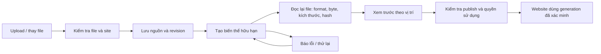

# Đề xuất tối ưu media bền vững trong CMS — US-086 / AC6

Ngày 24/10/2026. Trạng thái: **đề xuất triển khai**, chưa thay đổi schema,
code sản phẩm hoặc production. Contract nghiệm thu ở `AC6.md` cùng thư mục.
Nguồn baseline: `seo-audit-20261024/performance-images/REPORT.md`.

## 1. Kết luận thiết kế

Mở rộng **Media collection + Payload/Sharp + bộ hiển thị dùng chung** đang có.
CMS nhận file gốc, tự tạo bản dùng cho web, kiểm tra chất lượng kỹ thuật;
biên tập viên chọn media và xem trước đúng vị trí. Frontend chọn biến thể
theo layout/DPR, không dùng ảnh gốc làm thumbnail mặc định.

Giữ Payload-first, PostgreSQL production và Redis cho cache/KV. Không cần
thêm một CMS, collection DAM, queue Redis hoặc nhà cung cấp ảnh mới để xử lý
các finding hiện tại. Tác vụ media nặng có thể dùng Payload jobs đã tồn tại,
với worker riêng giới hạn tài nguyên và task được đăng ký rõ ràng.

### Bốn phương án đã so sánh

| Phương án | Tác dụng / giới hạn | Đề xuất |
| --- | --- | --- |
| P1: nén thủ công các file đang lớn | Giảm tải nhanh nhưng lần upload sau có thể lặp lỗi; phụ thuộc người biên tập | Chỉ là biện pháp khởi đầu có kiểm chứng |
| P2: mở rộng pipeline CMS hiện có | Tái sử dụng sizes, Sharp, media quan hệ, site access, jobs; kiểm soát được lúc upload và lúc render | **Chọn làm hướng triển khai** |
| P3: resize theo request qua Next/CDN | Có thể giảm lưu biến thể nhưng phải chứng minh forwarding, tenant, draft và cache an toàn; URL w=640 hiện chưa bảo đảm output | Chưa bật đại trà; ưu tiên phục vụ biến thể đã tạo |
| P4: chuyển DAM/CDN/video platform | Có ích khi dung lượng/lưu lượng thực vượt năng lực nhưng thêm vận hành, chi phí và migration | Đánh giá riêng khi có số liệu công suất |

## 2. Tận dụng những gì đã có và sửa đúng chỗ thiếu

| Hiện trạng trong repo | Thay đổi dự kiến |
| --- | --- |
| `Media.ts` có sizes 300/500 square/600/900/1400/1920/OG và sáu WebP/AVIF Group | Kiểm kê output tồn tại; dùng lại trước khi thêm profile; không nhân mọi width × crop × format cho mọi upload |
| Group có governance, quyền sử dụng, hash và EXACT sáu biến thể 640/960/1440 × hai format | Giữ nguyên contract này; không đổi managedBy của Go thành Group hoặc giảm kiểm tra publish |
| ImageMedia chỉ bật picture responsive cho Group published | Resolver biến thể dùng chung cho media được phép xem; giữ quyết định publication/rights riêng từng site |
| Direct /media được phục vụ qua route giữ site context; optimizer có hạn chế context | Giữ route này; whitelist tên size được phục vụ và kiểm tra parent media/site/publication trước đọc file |
| Public route hiện lookup original + sáu Group size | Thêm lookup cho profile thực dùng khi triển khai, không chỉ tạo file rồi để derivative404; không cho đọc mọi filename trên disk |
| Hero có video.desktopVideo/mobileVideo/poster nhưng mockup dùng media mp4 trực tiếp | Kết nối mockup với cấu hình sẵn có, preview/validation cùng runtime; không tạo bộ field video thứ hai |
| Jobs đã có cho lead, chưa có media task | Thêm media task chỉ khi cần xử lý nền; queue media tách lịch/tài nguyên khỏi lead; không chạy encode nặng trong request public |

`PAYLOAD_IMPORT_ORIGINALS_ONLY` và local preview có thể bỏ qua tạo sizes.
Import/backfill phải báo rõ biến thể chưa sẵn sàng, không coi record có URL là
đã tối ưu. Đối chiếu migration/schema đang deploy trước khi dùng cột size mới.

## 3. Luồng CMS từ upload đến publish

### Nhận file và xử lý

- Kiểm tra quyền/site, MIME thực bằng decode/probe, giới hạn byte, pixel,
  frame/duration theo loại; file giả đuôi và file lỗi không vào trạng thái ready.
  Giữ orientation, transparency, thông tin quyền sử dụng; bản public bỏ GPS
  nếu có, không sửa file gốc để đạt kích thước web.
- Kích thước variant = min(kích thước nguồn sau orientation, kích thước profile),
  giữ tỷ lệ trừ crop được chọn rõ. Không upscale để làm đúng tên kích thước;
  srcset mô tả **width thật của file**, không width ghi cứng trong tên profile.
- Profile khởi đầu: dùng lại 640/960/1440 WebP+AVIF hiện có. Thumbnail 160/320
  WebP chỉ bổ sung nếu thiếu đầu ra nhỏ đáp ứng AC6; schema/migration và route
  phải đi cùng. Không ép asset nhỏ tạo sáu bản lớn để hợp lệ; Group giữ contract
  cũ: nguồn Group mới phải đủ effective width ≥1440 sau orientation/crop,
  nếu không thì giữ draft và chỉ giữ bản cũ nếu còn được phép public. Hỗ trợ
  nguồn Group nhỏ hơn cần quyết định contract riêng; Go dùng width thật,
  loại candidate không có và gộp width trùng, không quảng cáo sai srcset.
- Crop theo slot chỉ tạo khi cần; poster có chữ được preview đủ nội dung.
  Không cắt chữ/giá/điều khoản quan trọng để giảm byte.

### Trạng thái kỹ thuật và tính nhất quán

**G-Async:** đo latency upload/replace, CPU/RAM đỉnh trên ARM staging với ảnh
PNG lớn trước khi chọn sync hay async; chốt ngưỡng trước code. Giữ pipeline
sync hiện có nếu đáp ứng. Desired/active generation, CAS/lease/worker dưới
đây chỉ áp dụng khi async được chọn; không xây chúng chỉ để có thứ đem test.
Với sync vẫn test hai replace đồng thời, metadata/file nhất quán và recovery
khi crash giữa filesystem/database. Không nhân state nếu metadata hiện có đủ.

Đề xuất trạng thái server quản lý `pending → processing → ready`, nhánh lỗi
`failed`; tách khỏi draft/published và rights approval. Dùng metadata hiện có
khi đủ; field kỹ thuật còn thiếu chỉ thêm qua migration tương thích ngược,
không giả định các field/trạng thái này đã có trên production.

- Identity gồm mediaID + siteID + source revision/hash + profile version + crop.
  Hai job cùng identity không sinh hai bản active; job revision cũ hoàn thành
  sau revision mới không được ghi đè kết quả mới.
- Worker khởi đầu concurrency1 trên ARM64; giới hạn CPU/RAM/time và kiểm tra
  disk trước chạy. Nếu dùng jobs, tối đa ba lần thử lại sau lần đầu, có backoff;
  lỗi file không hợp lệ báo ngay, không retry vô hạn. Job bị ngắt có lease hoặc
  cơ chế thu hồi để không kẹt processing vĩnh viễn.
- Phân biệt desired generation, active generation và attempt của worker.
  Ghi file tạm private, kiểm tra rồi rename vào tên generation riêng; đổi
  con trỏ bằng **atomic conditional update** khớp revision và quyền/publication
  hiện tại, không dùng đọc-rồi-update. Job cũ không ghi đè status/error mới
  hoặc tự phục hồi trạng thái publish đã bị thu hồi. Filesystem và database
  không là một transaction; crash trước/sau đổi con trỏ phải recovery idempotent.
- Thay ảnh trên trang đã public: giữ generation tốt trước đó phục vụ khách
  đến khi bản mới hoàn chỉnh và được duyệt, với điều kiện bản cũ vẫn được phép
  public; thu hồi quyền phải thắng quy tắc giữ ảnh cũ.
  Technical ready không tự cho phép publish hoặc cấp quyền xem ảnh draft.

### Trải nghiệm người biên tập

Media library hiển thị dung lượng/kích thước nguồn và bản web, trạng thái xử
lý, lỗi dễ hiểu và hành động thử lại khi có quyền. Preview thumb/card/hero
mobile-desktop; cảnh báo chữ poster bị crop, file thiếu nét và vượt budget.

Editor chọn ảnh/video, alt và focal point theo slot; không phải nhập URL
biến thể, srcset, MIME, quality hay fetchpriority. Publish mới chặn khi slot
bắt buộc thiếu bản ready/poster, nhưng vẫn cho lưu draft và nêu đúng asset
cần sửa. Áp dụng sau khi đã kiểm tra tương thích nội dung cũ; không khóa mọi
trang đang public do backfill chưa hoàn tất.

**Quyết định user:** mọi ảnh editor upload vào WingsGo đều public ngay khi
upload thành công, không gate duyệt/publish/rights riêng cho media. Bản gốc
và derivative có file kế thừa cùng quyền theo site; không cần trang nào tham
chiếu hoặc trang đó đã publish. Readiness biến thể chỉ là chất lượng kỹ thuật,
không ngăn quyền public của ảnh gốc. Không thêm private/draft schema cho ảnh
Go. Group governance và quyền sửa/upload theo site giữ nguyên; quyết định
về ảnh không tự mở rộng sang video/tài liệu hoặc tenant khác.

## 4. Quy tắc frontend và video

- Một resolver lấy nguồn được phép phục vụ, dimensions thật, srcset và
  fallback. Component layout quyết định sizes/ratio/priority theo slot;
  không đưa lựa chọn kỹ thuật này cho editor.
- Chỉ candidate hero trên viewport đầu được ưu tiên; ảnh ecosystem dưới fold
  và slide ẩn không high-priority/preload. Preload phải khớp format/srcset/sizes
  mà picture chọn; nếu không thể bảo đảm, bỏ preload dư và đo lại candidate.
- Xác minh card Go, gallery, article, rich text, OG và schema không lấy URL
  gốc nặng do mappers riêng; không thay OG bằng bản thumbnail thiếu chất lượng.
- `/media` cùng host giữ site context; không bật `_next/image` toàn cục hoặc
  forward cookie/auth tới hostname không được phép để chữa resize.

Video hero dùng poster trong HTML ban đầu, đúng ratio và có nội dung ngay cả
khi JS/video lỗi. Dùng đúng một nguồn active theo viewport; CSS ẩn một trong
hai video không được coi là đã ngăn tải video ẩn.

- Bình thường: HTML đầu không có URL video tải được; sau poster decode, DOM
  ready và nội dung đầu hiện, hero còn trong viewport, chờ idle có deadline
  rồi mới gắn một nguồn active và thử muted autoplay. Không chờ LCP cuối hay
  window.load vì chính video có thể trì hoãn load. Test timestamp gate và GET
  trước/sau trong AC6; reset eligibility khi tab/hero không còn hiển thị.
- Reduced motion, Save-Data (nếu browser cung cấp), autoplay bị chặn/lỗi:
  giữ poster và nút phát có thể thao tác bàn phím. Không phụ thuộc API mạng
  không được browser hỗ trợ. Cho tạm dừng/chạy theo accessibility.
- `preload="none"` đơn lẻ không ngăn autoplay tải; không gắn src sớm rồi
  kỳ vọng preload giải quyết cạnh tranh băng thông.
- Trước mắt dùng MP4 đã chuẩn bị đạt yêu cầu, codec tương thích browser, faststart,
  và thời lượng đủ thiết kế; tắt audio track với video trang trí không dùng âm.
  Nếu chưa có encoder/công suất thì chưa hứa CMS tự transcode video; ghi quyết
  định năng lực riêng. Encode nặng không chạy trong request web.
- MIME public `video/mp4`. Test GET200, range206 với đúng Content-Range/Length,
  bounded/open-ended/suffix range206 đúng bytes, range không thể đáp ứng416;
  xem/seek ở browser. CDN206 hiện tại chưa chứng minh
  origin route hỗ trợ range: route repo chỉ set Accept-Ranges rồi stream200.

## 5. Vận hành và phạm vi thay đổi

Cache/quyền truy cập, backfill, rollback và bảng module/test được tách sang
`OPERATIONS.md`; đây là phần bắt buộc của đề xuất P2 và AC6.

## 8. Tham chiếu

Đối chiếu tài liệu chính thức ngày24/10/2026; kiểm tra API đúng phiên bản cài
Payload3.84.1/Next16.2.6 trước code, không nâng package chỉ để khớp docs mới:

- Payload Uploads: https://payloadcms.com/docs/upload/overview
- Payload Tasks: https://payloadcms.com/docs/jobs-queue/tasks
- Next Image: https://nextjs.org/docs/app/api-reference/components/image
- Video loading: https://web.dev/articles/lazy-loading-video
- Tham vấn độc lập: `consultation-request.md`, `consultation-result.txt`;
  xử lý finding được ghi trong `review-resolution.md` trước chốt đề xuất.
